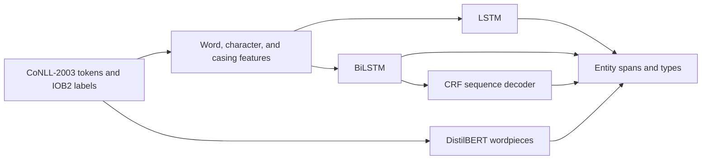

<div align="center">

# Named Entity Recognition
### CoNLL-2003 · Sequence Labeling with LSTM, BiLSTM-CRF & DistilBERT

[](https://www.python.org/)
[](https://pytorch.org/)
[](https://huggingface.co/)
[](https://www.gradio.app/)

**Best recorded test entity F1: 0.9039 · BiLSTM + CRF**

A complete named entity recognition workflow: dataset exploration, feature engineering, model training, entity-level evaluation, error analysis, and interactive text highlighting.

</div>

---

## Project overview

This project identifies and classifies named entities in English text. It benchmarks three recurrent sequence taggers against a fine-tuned transformer on the CoNLL-2003 dataset.

| At a glance | Details |
|---|---|
| **Task** | Named entity recognition (token-level sequence labeling) |
| **Dataset** | CoNLL-2003 English newswire |
| **Entity labels** | PER · ORG · LOC · MISC |
| **Models** | LSTM · BiLSTM · BiLSTM + CRF · DistilBERT |
| **Best recorded model** | BiLSTM + CRF |
| **Best test entity F1** | **0.9039** |
| **Interactive app** | Gradio span-highlighting interface |

## Results

The comparison below reports the saved run. Precision, recall, and F1 use `seqeval` entity-level micro scoring: a prediction is correct when both the entity boundaries and type match. Validation F1 is used to select the model; the test set is used for final reporting.

| Model | Test precision | Test recall | Test F1 | Validation F1 | Token accuracy | Parameters (M) | Train time (min) |
|---|---:|---:|---:|---:|---:|---:|---:|
| **BiLSTM + CRF** | **0.9043** | 0.9035 | **0.9039** | **0.9416** | **0.9796** | 3.1444 | 5.31 |
| Fine-tuned DistilBERT | 0.8889 | **0.9026** | 0.8957 | 0.9338 | 0.9791 | 65.1978 | 2.72 |
| BiLSTM | 0.8818 | 0.8971 | 0.8894 | 0.9321 | 0.9787 | 3.1443 | 1.16 |
| LSTM | 0.8057 | 0.8522 | 0.8283 | 0.8771 | 0.9711 | 2.8529 | 1.27 |

### Test F1 by entity type

| Entity | LSTM | BiLSTM | **BiLSTM + CRF** | DistilBERT |
|---|---:|---:|---:|---:|
| PER | 0.9231 | 0.9542 | **0.9546** | 0.9512 |
| ORG | 0.7658 | 0.8559 | **0.8781** | 0.8696 |
| LOC | 0.8586 | 0.9071 | **0.9227** | 0.9216 |
| MISC | 0.6993 | 0.7796 | **0.8069** | 0.7741 |
| **Overall micro** | 0.8283 | 0.8894 | **0.9039** | 0.8957 |

The BiLSTM + CRF model leads on overall test F1 and on each entity category in this run. MISC is the most challenging category across all four models.

## Modeling approach



### Recurrent models

The recurrent models combine 100-dimensional GloVe word vectors with capitalization features and character-level CNN features. The LSTM reads each sequence from left to right; the BiLSTM adds right-to-left context; the BiLSTM + CRF scores complete tag sequences using learned transition scores.

### Transformer model

`distilbert-base-cased` is fine-tuned for token classification. Each word's label is aligned to its first wordpiece; special tokens and continuation pieces are excluded from the loss and word-level evaluation.

### IOB2 and error analysis

The notebook converts labels to IOB2 and checks entity spans with `seqeval`. Its error analysis separates exact matches, type errors, boundary errors, missed entities, and spurious predictions. In the recorded run, invalid IOB2 transitions fell from **322** with LSTM and **74** with BiLSTM to **5** with BiLSTM + CRF.

## Dataset

The notebook loads [CoNLL-2003 from Hugging Face](https://huggingface.co/datasets/eriktks/conll2003), compatible text files attached under `/kaggle/input`, or a downloadable archive when needed. Data is fetched at runtime and is not bundled with this repository.

| Split | Sentences | Tokens | Entities |
|---|---:|---:|---:|
| Train | 14,041 | 203,621 | 23,499 |
| Validation | 3,250 | 51,362 | 5,942 |
| Test | 3,453 | 46,435 | 5,648 |

The label set contains **PER** (person), **ORG** (organization), **LOC** (location), and **MISC** (miscellaneous). CoNLL-2003 does not annotate dates as a separate entity type. Please consult the [dataset card](https://huggingface.co/datasets/eriktks/conll2003) for dataset terms and attribution.

## Interactive demo

The final notebook cell starts a local Gradio app. Enter or paste text to see color-coded entity spans and a structured list of detected entities. The packaged notebook launches locally by default; a temporary public link can be enabled explicitly when needed.

## Run the project

### Recommended environment

- Kaggle Notebook or Jupyter environment
- Python 3.11 or newer
- CUDA-enabled GPU recommended; the saved run used a **Tesla T4**
- Internet access to download the dataset, GloVe vectors, and DistilBERT weights

### Steps

```bash
pip install -r requirements.txt
jupyter lab named-entity-recognition-system.ipynb
```

Open the notebook and run all cells from top to bottom. In Kaggle, enable Internet and select a GPU accelerator before running. The notebook installs `seqeval` when needed and writes generated metrics and model files under `/kaggle/working` or `./working`.

## Repository contents

```text
.
├── named-entity-recognition-system.ipynb  # Full workflow and saved experiment outputs
├── requirements.txt                       # Python dependencies
├── README.md                              # Project documentation
└── .gitignore                             # Runtime files and checkpoints excluded from Git
```

The notebook exports a model comparison table, per-entity F1 scores, the label map, and the selected model checkpoint.

## Future enhancements

- Add hard IOB2 transition constraints to CRF decoding.
- Add multi-seed evaluation with confidence intervals.
- Add a train-only vocabulary configuration for strict inductive benchmarks.
- Publish a hosted Gradio demo and report inference latency.

## References

- [CoNLL-2003 dataset card](https://huggingface.co/datasets/eriktks/conll2003)
- [DistilBERT base cased](https://huggingface.co/distilbert/distilbert-base-cased)
- [GloVe: Global Vectors for Word Representation](https://nlp.stanford.edu/projects/glove/)
- [seqeval](https://github.com/chakki-works/seqeval)
